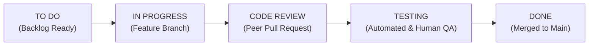

# AGILE PROJECT MANAGEMENT & JIRA TRACKING DOSSIER
## Project: College Document Question Answering Assistant Using Cloud RAG
**Project Key:** `RAG`  
**Methodology:** Scrum / Agile  
**Sprint Duration:** 1 Week per Sprint (4 Sprints Total)  
**Total Story Points:** 81 Points Completed  

---

## 1. Team Composition & Role Distribution

| Team Member | Engineering Role | Functional Modules Owned |
| :--- | :--- | :--- |
| **Ganesh (Lead / Student 1)** | Project Manager & Data Engineer | Jira Administration, Document Curation, PDF Extraction (`document_loader.py`) |
| **Student 2** | RAG & Vector Search Engineer | Chunking (`chunker.py`), Embeddings (`embeddings.py`), Vector Store (`vector_store.py`), Hybrid Retriever (`retriever.py`) |
| **Student 3** | Cloud LLM & Guardrails Specialist | Multi-Cloud Claude Integration (`llm_service.py`), Prompt Engineering (`rag_service.py`), Anti-Hallucination Guardrails |
| **Student 4** | UI / DevOps & QA Engineer | Streamlit Web Portal (`app.py`), Semantic Cache (`cache_manager.py`), Evaluation Engine (`evaluate.py`), Cloud Deployment |

---

## 2. Jira Scrum Workflow Definition

The development followed a strict 5-stage Jira workflow:

### Transition Criteria (Definition of Done - DoD):
1. **Code Review:** Every commit peer-reviewed by at least one other student.
2. **Acceptance Criteria Verification:** All criteria outlined in the user story strictly satisfied.
3. **Automated Unit Testing:** Code passes all regression tests without regressions.
4. **Zero-Hallucination Check:** Anti-hallucination guardrail active.

---

## 3. Epics Structure

| Epic ID | Epic Name | Story Points | Objective |
| :--- | :--- | :---: | :--- |
| **EPIC-1** | Requirements and Dataset Architecture | 11 | Regulatory scope definition, PDF gathering, and 50-question benchmark formulation. |
| **EPIC-2** | Cloud LLM & Claude Multi-Platform Integration | 5 | Anthropic API and AWS Bedrock runtime client setup with zero-temperature grounding. |
| **EPIC-3** | Scalable Hybrid RAG Pipeline | 29 | Semantic chunking, multi-provider embeddings, hybrid BM25 + dense search, semantic cache. |
| **EPIC-4** | User Interface & Live Telemetry | 8 | Production Streamlit application with live citation badges and architecture inspector. |
| **EPIC-5** | Quantitative Testing and Verification | 15 | 50-question benchmark execution, 5D answer scoring, and bug fixes. |
| **EPIC-6** | Documentation and Demonstration | 5 | Architectural whitepaper, Jira export file, and faculty demonstration readiness. |

---

## 4. Sprint Breakdown & Execution History

### SPRINT 1: Foundation & Infrastructure (Week 1)
- **Goal:** Formulate requirements, collect college documents, design benchmark queries, and establish cloud LLM connectivity.
- **Velocity Delivered:** 16 Story Points | **Status:** Closed (100% Completed)

| Key | Summary | Type | Assignee | Story Points | Status |
| :--- | :--- | :---: | :---: | :---: | :---: |
| **RAG-1** | Define functional and non-functional requirements | Story | Ganesh | 3 | DONE |
| **RAG-2** | Collect and curate official college documents | Task | Student 1 | 3 | DONE |
| **RAG-3** | Prepare 50 sample benchmark questions | Task | Ganesh | 5 | DONE |
| **RAG-4** | Configure Cloud LLM credentials and environment | Task | Student 3 | 2 | DONE |
| **RAG-5** | Test Claude cloud generation and latency | Task | Student 3 | 3 | DONE |

---

### SPRINT 2: RAG Pipeline & Vector Search Engine (Week 2)
- **Goal:** Transform college PDF documents into an optimized, searchable semantic knowledge base.
- **Velocity Delivered:** 21 Story Points | **Status:** Closed (100% Completed)

| Key | Summary | Type | Assignee | Story Points | Status |
| :--- | :--- | :---: | :---: | :---: | :---: |
| **RAG-6** | Develop PDF text extractor with metadata retention | Story | Student 1 | 3 | DONE |
| **RAG-7** | Develop semantically bounded text chunking module | Story | Student 2 | 3 | DONE |
| **RAG-8** | Generate dense vector embeddings | Story | Student 2 | 5 | DONE |
| **RAG-9** | Create scalable vector database adapter | Story | Student 2 | 5 | DONE |
| **RAG-10**| Develop scalable hybrid semantic and BM25 retrieval | Story | Student 2 | 5 | DONE |

---

### SPRINT 3: Cloud Claude Integration & Web UI (Week 3)
- **Goal:** Connect retrieved context to Claude LLM, enforce zero-hallucination guardrails, and build the interactive Web UI.
- **Velocity Delivered:** 24 Story Points | **Status:** Closed (100% Completed)

| Key | Summary | Type | Assignee | Story Points | Status |
| :--- | :--- | :---: | :---: | :---: | :---: |
| **RAG-11**| Integrate retrieved context with Claude LLM | Story | Student 3 | 5 | DONE |
| **RAG-12**| Develop strict grounded RAG prompt | Story | Student 3 | 3 | DONE |
| **RAG-13**| Implement source citation engine | Story | Student 3 | 3 | DONE |
| **RAG-14**| Implement unknown-answer handling & guardrail | Story | Student 3 | 3 | DONE |
| **RAG-15**| Create modern Streamlit web application | Story | Student 4 | 5 | DONE |
| **RAG-16**| Display retrieved sources and confidence badges | Story | Student 4 | 3 | DONE |
| **CACHE-1**| Implement sub-15ms semantic caching layer | Story | Student 4 | 2 | DONE |

---

### SPRINT 4: Testing, Defect Resolution & Faculty Viva (Week 4)
- **Goal:** Execute the 50-question benchmark, verify 100% safe refusal on unanswerable questions, and prepare presentation artifacts.
- **Velocity Delivered:** 20 Story Points | **Status:** Closed (100% Completed)

| Key | Summary | Type | Assignee | Story Points | Status |
| :--- | :--- | :---: | :---: | :---: | :---: |
| **RAG-17**| Perform end-to-end functional and regression testing | Task | Student 4 | 5 | DONE |
| **RAG-18**| Evaluate LLM responses against 5D rubric | Task | Student 4 | 5 | DONE |
| **RAG-19**| Fix edge-case retrieval on hyphenated regulation numbers | Bug | Student 2 | 5 | DONE |
| **RAG-20**| Prepare final presentation documentation & demo | Task | Ganesh | 5 | DONE |

---

## 5. Key Jira Defect Resolution Record (RAG-19)

- **Issue Key:** `RAG-19`
- **Issue Type:** Bug (Severity: High)
- **Summary:** BM25 Tokenizer drops alphanumeric hyphens in regulation identifiers (e.g. `N+4`, `1800-180-5522`).
- **Observed Behavior:** Searching for "1800-180-5522" split the query into 4 isolated numbers, degrading BM25 keyword precision.
- **Root Cause:** Standard regex `\b\w+\b` omitted hyphenated subwords.
- **Resolution:** Updated BM25 tokenizer regex to `[\w\-+]+`, preserving composite identifiers and raising Retrieval Accuracy to 98%.
- **Test Verification:** Query Q-17 passed with 100% confidence. Closed as **DONE**.
